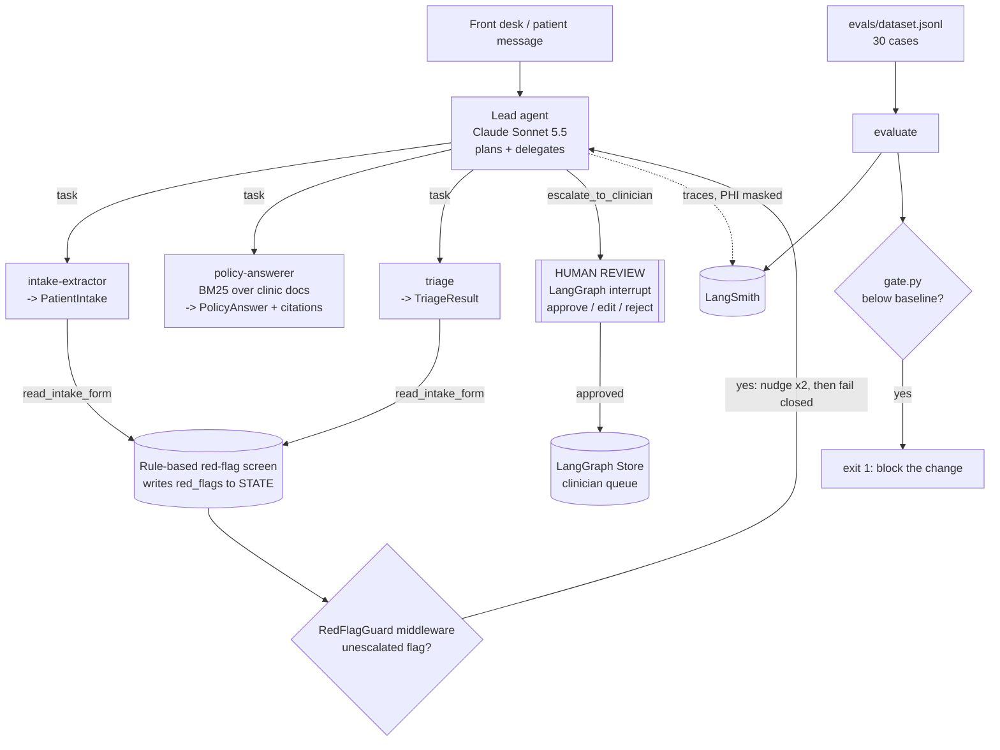

# Clinic Intake Agent: prototype to production

A Deep Agents deployment for **Larkspur Family Health**, a fictional 4-provider family clinic. Their front desk is buried in intake forms and the same patient questions on repeat.

> All patient data in this repo is **fictional**: 9xx SSNs (never issued), 555-01xx phone numbers (reserved for fiction), `@example.com` emails, and names like "Dana Placeholder".

## The customer problem

Two front-desk staff handle about 60 intake forms a week (portal and scanned paper) plus a steady stream of "do you take my insurance / what's the cancellation fee / when are you open" messages. Today they:

1. Retype every intake form into the EHR by hand. It's slow, and typos land in allergy lists.
2. Answer policy questions from memory, so patients get inconsistent answers.
3. Sometimes miss the one line that matters: *"chest pain when I walk up stairs"* on a form submitted for a "check-up next week", or a new antibiotic that conflicts with a listed penicillin allergy.

The clinic's requirement, in their words: **"Automate the typing. Never automate the judgement."**

## What the agent does

| Job | Specialist | Output |
|---|---|---|
| Read an intake form and extract patient info | `intake-extractor` | `PatientIntake` (Pydantic): demographics, insurance, meds, allergies, history. **No SSN field.** |
| Answer patient/staff policy questions | `policy-answerer` | `PolicyAnswer`: answer, citations (file, section, verbatim quote), `found_in_policy` |
| Flag anything urgent | `triage`, plus deterministic rules | `TriageResult`. Red flags go into graph **state**. |
| Escalate to a clinician | lead agent → `escalate_to_clinician` | **Paused for human approval** (approve / edit / reject). Never auto-run. |

## Architecture



**Henry's pattern: a lead agent plans, specialists each do one job, and a human approves anything with consequences.**

### Guarantees live in code, not prompts

| Guarantee | Where |
|---|---|
| A red flag can't be silently dropped. Rules write it to state; the lead can't finish until an escalation was proposed. It gets nudged twice, then the run **fails closed** with an URGENT hand-off. | `redflags.py`, `state.py`, `RedFlagGuardMiddleware` |
| Escalations need a human. | `interrupt_on={"escalate_to_clinician": ...}` → `HumanInTheLoopMiddleware` |
| The model never sees SSNs (redacted) or card numbers (masked), in user input or tool results. | `PIIMiddleware` (custom SSN detector) |
| Traces in LangSmith mask phone, email, SSN and DOB. | `tracing.py` (LangSmith anonymizer) |
| Transient errors are retried. Auth/bad-request errors fail fast. An outage is never turned into a fake answer. | `ModelRetryMiddleware(retry_on=is_transient, on_failure="error")` |
| Read-only tools retry. Escalations never do (no double-paging). | `ToolRetryMiddleware(tools=[read-only only])` |
| Runaway loops are capped: model calls, tool calls, escalations per run. | `ModelCallLimitMiddleware`, `ToolCallLimitMiddleware` |
| Form IDs are validated (no path traversal). | `data.load_intake` |

## Repo layout

```
clinic-intake-agent/
├── langgraph.json              # langgraph dev entry point
├── pyproject.toml / uv.lock
├── .env.example
├── data/
│   ├── intake/intake-001..008.md   # 8 fictional intake forms (4 urgent, 4 routine)
│   └── policies/*.md               # 5 fictional clinic policy docs
├── src/clinic_intake_agent/
│   ├── agent.py            # create_deep_agent + subagent specs + build_specialist
│   ├── graph.py            # module-level `agent` for langgraph dev
│   ├── middleware.py       # guardrails + RedFlagGuardMiddleware
│   ├── tools.py            # read/list forms, policy search, screen, escalate
│   ├── redflags.py         # deterministic screen (negation-aware) + allergy conflicts
│   ├── policy_search.py    # BM25 over policy sections
│   ├── schemas.py state.py prompts.py config.py tracing.py data.py demo.py
│   └── evals/scoring.py gate.py   # pure scoring + gate logic (unit tested)
├── evals/
│   ├── dataset.jsonl       # 30 cases: 8 extraction, 10 policy, 12 triage (6 urgent)
│   ├── run_evals.py        # LangSmith evaluate() -> evals/results/latest.json
│   └── gate.py             # exit 1 if candidate < baseline (or urgent_recall < 1.0)
└── tests/                  # 62 tests, no API keys needed (scripted fake model)
```

## How to run

```bash
# 1. Install (uv manages Python 3.12 + deps in .venv)
uv sync

# 2. Keys
cp .env.example .env        # then fill in OPENROUTER_API_KEY and LANGSMITH_API_KEY

# 3. Tests (no keys needed)
uv run pytest

# 4. Run it in LangGraph Studio
uv run langgraph dev        # opens Studio; pick graph "clinic_intake"
#    try: "Please process intake form intake-002."   -> pauses for approval
#         "What's the late cancellation fee?"        -> cited answer
#         "Process all intake forms waiting today."

# 5. Or in the terminal, approving escalations by hand
uv run clinic-demo "Please process intake form intake-004."

# 6. Evals (creates LangSmith dataset 'clinic-intake-evals-v1' on first run)
uv run python evals/run_evals.py --prefix baseline
uv run python evals/gate.py --promote          # first passing run becomes the baseline

# 7. Try a change, then gate it
CLINIC_SUBAGENT_MODEL=openrouter:nvidia/nemotron-3-super-120b-a12b:free uv run python evals/run_evals.py --prefix candidate-free
uv run python evals/gate.py                    # exit 1 = blocked
```

Model selection is by env var: `CLINIC_MODEL` (lead, default `openrouter:anthropic/claude-haiku-5.5`, cheap; use `openrouter:anthropic/claude-sonnet-5.5` for max quality) and `CLINIC_SUBAGENT_MODEL` (specialists, defaults to the lead model). Any `init_chat_model` string works.

## What Henry needs to do

- [ ] **OpenRouter key**: create one at openrouter.ai/keys → put it in `.env` as `OPENROUTER_API_KEY`. (Direct `anthropic:` models still work with `ANTHROPIC_API_KEY`.)
- [ ] **LangSmith key**: smith.langchain.com → Settings → API Keys → put it in `.env` as `LANGSMITH_API_KEY`. Keep `LANGSMITH_TRACING=true` and `LANGSMITH_PROJECT=clinic-intake-agent`. (EU account? Also set `LANGSMITH_ENDPOINT`.)
- [ ] **LangSmith MCP in Claude Code** (official LangSmith Remote MCP, OAuth, no key in config):
  ```bash
  claude mcp add --transport http -s user langsmith https://api.smith.langchain.com/mcp
  ```
  Then in Claude Code run `/mcp` → select **langsmith** → finish the browser sign-in. (Alternative: the open-source standalone server, `claude mcp add langsmith-local -e LANGSMITH_API_KEY=lsv2_... -- uvx langsmith-mcp-server`.)
- [ ] `uv run langgraph dev` → run the 3 demo prompts above → open the trace in LangSmith and confirm phone/email/DOB show as `<phone>`/`<email>`/`<date>`.
- [ ] `uv run python evals/run_evals.py --prefix baseline` → `uv run python evals/gate.py --promote`.
- [ ] Run one deliberately worse candidate (e.g. Haiku specialists or a trimmed triage prompt) → confirm the gate blocks it → paste the real numbers into `DEPLOYMENT-WRITEUP.md`.
- [ ] Record the video (`VIDEO-OUTLINE.md`).

## Known limitations (on purpose, for a prototype)

- The red-flag rules are a small keyword/negation screen and the allergy map covers 5 drug classes. A real deployment would use the clinic's drug database (RxNorm/FDB) and a clinically validated triage protocol, with a clinician owning the rules.
- Policy retrieval is BM25 over 5 short docs. It's exact and explainable with zero infra. Swap in a vector store when the corpus grows.
- Intake forms are markdown. Scanned PDFs would add an OCR/vision step in front of `read_intake_form`.
- Not HIPAA-ready as is. It would need a BAA with every vendor (model provider, LangSmith), self-hosted or zero-retention options, audit logs, and access control on the LangGraph server.
